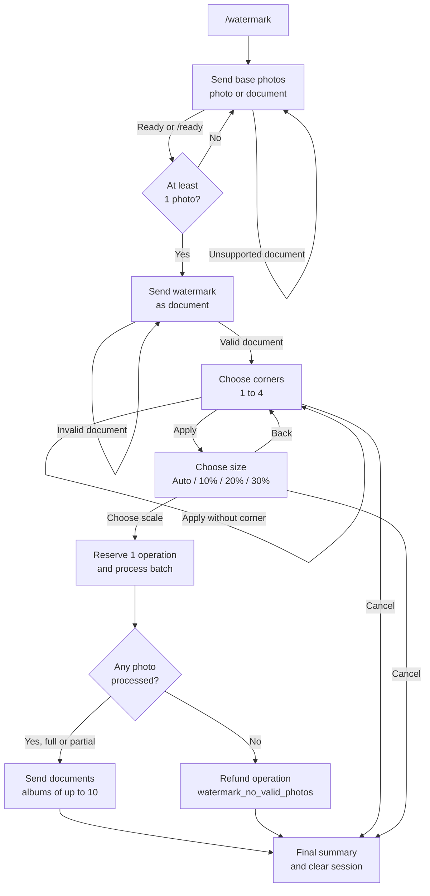

# Watermark

Business and technical documentation for the Picture Studio Bot watermark feature.

- **Command:** `/watermark`
- **Handler:** `src/handlers/watermark.handler.ts` (`WatermarkHandler`)
- **Last reviewed:** 2026-11-01

> This document is the reference for the feature. Any change affecting the behavior described here must update it in the same change (see the rule in `AGENTS.md`).

---

## 1. Business overview

### 1.1 What it is

The feature applies a **watermark image** to **batches of photos** in a single operation. The user sends the base photos, sends the watermark as a file (to preserve transparency), chooses which corners the watermark appears in, and picks its relative size. The bot returns the processed photos as **documents**, preserving the original format.

Unlike the other image operations, watermarking is **multi-step and multi-photo**: one command produces multiple outputs and consumes **a single operation** from the daily limit.

### 1.2 Value proposition

- Mark several photos at once (up to 100 on the Pro plan) without repeating the flow photo by photo.
- Visual control: independent corners (1 to 4) and four sizes (auto, small, medium, large).
- Quality and format preservation: output as documents, avoiding Telegram's recompression of photos.
- Transparency support (PNG/WebP with alpha) for discreet marks.

### 1.3 Audience and use cases

- Content creators who need to protect or sign images before publishing.
- Photographers and small businesses applying a logo to catalogs and portfolios.
- Batch usage: marketing material, product photos, client previews.

### 1.4 Plan limits

Watermark-specific limits:

| Rule | Free | Pro |
|---|---:|---:|
| Photos per operation | 3 | 100 |
| Items per album (media group) | 10 | 10 |

Global limits (operations per day and maximum file size, which also apply to the watermark file) are documented in the [README Limits](../README.md#limits).

- The whole batch counts as **1 operation**, regardless of the number of photos.
- The operation is **reserved** when processing starts and **refunded** (rolled back) if no photo is delivered.
- Limits live in `src/config/constants.ts` (`PHOTOS_PER_OPERATION_LIMITS`, `DAILY_LIMITS`, `MAX_FILE_SIZE`, `MAX_PRO_FILE_SIZE`, `WATERMARK_MEDIA_GROUP_SIZE`).

### 1.5 User flow



Detailed step by step:

1. **Base collection** — the bot asks for up to N photos. The user can send photos compressed by Telegram (`msg:photo`) or files (`msg:document`) in the supported formats.
2. **End of collection** — the **✅ Ready** button or the `/ready` text (accepts `/ready@bot_name`). With no photos, the bot just repeats the instruction (or shows an alert, in the button case).
3. **Watermark** — must be sent as a **file/document**, not as a photo, to avoid losing transparency. If the user sends a photo at this step, the bot explains that it must be sent as a file. If the image has no alpha, the bot warns that the mark will be applied as an opaque image.
4. **Positions** — a keyboard with four corners, toggled independently; the canonical order is top-left, top-right, bottom-left, bottom-right. At least one corner is required.
5. **Size** — `Auto (15%)`, `10%`, `20%`, or `30%` of the base photo width, with a height cap. There is a **Back** button to review the corners and **Cancel** on the corner and size steps.
6. **Result** — images are sent as documents. Up to 10 per album; larger batches are split into multiple sends. Progress is updated on the message and a final summary is shown.

### 1.6 Business rules

- **1 batch = 1 operation.** The reservation happens when processing starts; if no photo is delivered, the operation is refunded.
- **Supported images only:** JPEG, PNG, WebP, AVIF, and TIFF (input and output). HEIF with AV1 compression is treated as AVIF.
- **The watermark is an image**, not text. Unsupported formats are rejected with a specific message.
- **Watermark as a document:** sending it as a photo makes Telegram recompress it and drop transparency.
- **Format preserved per photo:** each output uses the format detected from the base (JPEG → JPG, PNG → PNG, WebP → WebP, AVIF → AVIF, TIFF → TIFF).
- **Multiple corners:** the same mark is applied to every selected corner.
- **Never upscales the mark:** the target width is capped at the watermark's original width.
- **Partial failures are tolerated:** failed photos are counted and the rest are delivered; the user gets a success/failure warning.
- **Total failure refunds the operation:** if no photo can be processed, the operation is refunded and the user is notified.
- **Cancel** clears the session and does not consume an operation.

### 1.7 Messages and error situations

| Situation | Behavior |
|---|---|
| Photo sent at the watermark step | Asks to send it as a file (`watermark_mark_as_file`) |
| Document with unsupported MIME type | `watermark_unsupported_format` |
| Invalid watermark/missing dimensions | `watermark_invalid_file` |
| No corner selected when applying | `watermark_select_at_least_one` alert |
| Ready with no photos | Alert (button) or repeats the instruction (`/ready`) |
| Plan photo limit reached | Single warning with the Ready button; extra photos are ignored |
| File above the plan limit | Plan limit warning; the photo is ignored |
| No photo processed | `watermark_no_valid_photos` + operation refund |
| Partial failure | Results delivered + `watermark_batch_summary_failures` |
| Unexpected error | `watermark_error` (logged) |

All messages go through `ctx.t(key)` and exist in `en.json`, `es.json`, and `pt.json`.

---

## 2. Technical overview

### 2.1 Files involved

| File | Responsibility |
|---|---|
| `src/handlers/watermark.handler.ts` | Full flow, validation, sharp composition, delivery, and cleanup |
| `src/schemas/index.ts` | `WatermarkParamsSchema`, `WatermarkConfiguredParamsSchema`, `WatermarkProcessParamsSchema`, corner/scale/step enums |
| `src/config/constants.ts` | Plan limits, album size, maximum photos |
| `src/handlers/base.handler.ts` | `checkLimits`, `runWithUsage`, `validateParams`, `resetSession`, image validation |
| `src/errors/invalid-watermark.error.ts` | Invalid watermark error |
| `src/handlers/index.ts` | Registers the instance in `coreHandlers` |
| `src/enums/command.enum.ts` | `CommandEnum.Watermark = 'watermark'` |
| `src/handlers/watermark.handler.spec.ts` | Unit tests (sharp/fs/os/InputFile mocked) |
| `src/locales/{en,es,pt}.json` | `watermark_*` keys |

### 2.2 Registration and routing

- The handler is registered in `coreHandlers` and included in `handlers`, which makes the `/watermark` command automatically published in `setMyCommands` and listed in `/help`.
- `src/index.ts` registers one listener per event filter (`msg:photo`, `msg:document`, `msg:text`, `callback_query`) and routes to the handler whose `command` equals `ctx.session.command`.
- `/watermark` calls `onCommand`, which sets `ctx.session.command = 'watermark'` and initializes the parameters.
- `/ready` is **not** a registered command: it is handled by the handler's `msg:text` event, with the regex `^\/ready(?:@\w+)?$/i`.

### 2.3 Session state machine

The session is persisted in MongoDB (`sessions`, via `MongoDBAdapter`) and survives restarts. The discriminator is `params.step`:

```mermaid
stateDiagram-v2
    [*] --> collecting_bases
    collecting_bases --> awaiting_watermark : /ready | Ready
    awaiting_watermark --> positions : valid file
    positions --> scale : Apply
    scale --> processing : Choose scale
    processing --> [*] : done
    positions --> collecting_bases : Cancel
    scale --> positions : Back
```

States:

| `step` | Meaning | Accepted events |
|---|---|---|
| `collecting_bases` | Collecting base photos | `msg:photo`, `msg:document`, `msg:text` (`/ready`), `callback_query` (`watermark_ready`, `watermark_cancel`) |
| `awaiting_watermark` | Waiting for the watermark file | `msg:document`, `callback_query` (`watermark_cancel`) |
| `positions` | Choosing corners | `callback_query` (toggle, `watermark_apply`, `watermark_cancel`) |
| `scale` | Choosing size | `callback_query` (scale, `watermark_back`, `watermark_cancel`) |

Callbacks are ignored when the `step` does not match or when the pressed message is not the keyboard tracked in `params.callback_message_id` (stale keyboards from an earlier batch), preventing out-of-order actions (e.g., double clicks, stale buttons).

### 2.4 Session data model

`WatermarkParamsSchema` (`src/schemas/index.ts`):

| Field | Type | Default | Notes |
|---|---|---|---|
| `step` | `collecting_bases \| awaiting_watermark \| positions \| scale` | — | Flow discriminator |
| `base_file_ids` | `string[]` | `[]` | `file_id` of the base photos |
| `watermark_file_id` | `string?` | — | `file_id` of the watermark document |
| `positions` | `WatermarkCorner[]` | `[]` | `top-left`, `top-right`, `bottom-left`, `bottom-right` |
| `scale` | `auto \| small \| medium \| large` | `auto` | Chosen scale |
| `limit_warned` | `boolean?` | — | Ensures a single limit warning per batch |
| `callback_message_id` | `number?` | — | Message ID of the keyboard shown for the active batch; ignored callbacks come from other messages |
| `paths` | `string[]?` | — | Reserved for temporary file cleanup by `BaseHandler` |

Derived schemas:

- `WatermarkConfiguredParamsSchema`: requires `base_file_ids` between 1 and `WATERMARK_MAX_PHOTOS` (100) and a present `watermark_file_id`. Used after collection.
- `WatermarkProcessParamsSchema`: adds `positions` with at least 1 item. Used before processing.

Session validation uses `WatermarkParamsSchema.safeParse`; failures throw `SessionValidationError`, handled in `src/index.ts` with a warning and session reset. Later-step parameters use `validateParams` (which also throws `SessionValidationError`).

### 2.5 Events and callbacks

| Event | Action |
|---|---|
| `msg:photo` | `collecting_bases`: collects the highest resolution. `awaiting_watermark`: asks for a file. Others: ignored |
| `msg:document` | `collecting_bases`: collects if the MIME type is supported. `awaiting_watermark`: validates and configures the mark |
| `msg:text` | `/ready` (with or without `@bot`) in `collecting_bases`: ends collection |
| `callback_query` | Dispatches by the `data` values below |

| Callback data | Action |
|---|---|
| `watermark_ready` | Ends collection (with an alert if there are no photos) |
| `watermark_cancel` | Resets the session and edits the message to "cancelled" (only when the callback comes from the tracked keyboard) |
| `watermark_toggle_tl` / `_tr` / `_bl` / `_br` | Toggles the matching corner and updates the keyboard |
| `watermark_apply` | Validates at least one corner and moves to `scale` |
| `watermark_back` | Goes back from `scale` to `positions` |
| `watermark_scale_auto` / `_small` / `_medium` / `_large` | Starts processing with the chosen scale |

Every callback that acts on the batch is ignored unless the pressed message matches `params.callback_message_id`; the tracked ID is set from the positions keyboard message when the mark is accepted.

### 2.6 Collection and limits

- `onCommand` initializes `{ step: 'collecting_bases', base_file_ids: [], positions: [], scale: 'auto' }`.
- `collectBase` calls `checkLimits(ctx, { fileSize })` before accepting; `LimitExceededError` is silenced in `safely` (the limit warning was already sent by `notifyLimitExceeded`).
- When the limit is reached, `limit_warned` ensures a **single warning**; subsequent photos are ignored.
- The limit is recalculated on every interaction via `getPhotoLimit` (`ctx.user.plan_type === Pro ? 100 : 3`).
- `finishCollection` truncates `base_file_ids` to the current limit before advancing, covering a plan downgrade mid-flow.
- `getFile`/`download` only happen during processing; collection stores only `file_id` and `file_size`.

### 2.7 Watermark validation

`collectWatermark`:

1. Requires `msg:document` and a MIME type in `SUPPORTED_MIME_TYPES` (`image/jpeg`, `image/png`, `image/webp`, `image/avif`, `image/tiff`).
2. Applies `checkLimits` using `file_size`.
3. Downloads the file (`ctx.api.getFile(...).download()`), then re-applies `checkLimits` using the actual downloaded byte size (`fs.stat`), covering documents whose `file_size` Telegram omits.
4. Validates it with `sharp.metadata()` and requires `width`, `height`, and a resolvable output format.
5. Saves `watermark_file_id`, truncates the bases to the limit, and switches to `step: 'positions'`.
6. Warns about missing transparency when `metadata.hasAlpha` is false.
7. Removes the downloaded file in `finally` (the mark is downloaded again during processing).

Image errors become `InvalidWatermarkError` → `watermark_invalid_file` message.

### 2.8 Processing

`process` validates `WatermarkProcessParamsSchema`, truncates the bases to the limit, fixes the scale, and starts `processBatch`.

`processBatch`:

1. Wraps everything in `runWithUsage`, which **reserves 1 operation** before processing and **refunds** it if nothing is delivered.
2. Downloads the mark once per batch and reads the buffer; dimensions use `autoOrient` when available.
3. Splits the bases with `chunk(..., WATERMARK_MEDIA_GROUP_SIZE)` (10).
4. Processes photos **sequentially** within each chunk; individual failures are logged and counted. Each downloaded photo is re-checked against the plan limit using its actual byte size before processing.
5. Sends the chunk: 1 item → `replyWithDocument`; 2–10 → `replyWithMediaGroup` with the caption on the first item.
6. On the first successful delivery, calls `markDelivered()`, confirming the operation consumption.
7. Removes the chunk's output files, updates progress (`watermark_progress`), and waits `chunkDelayMs = 1000 ms` between chunks (except the last).
8. If `success === 0`, throws `InvalidFileError` → refund + `watermark_no_valid_photos`.
9. If there were partial failures, sends `watermark_batch_summary_failures`.
10. Edits the final message with `watermark_batch_summary`.
11. In `finally`: removes all tracked temporary files and resets the session.

Captions:

- Batch with a single chunk and a single photo: `watermark_success`.
- Multiple chunks: `watermark_batch_chunk` (`Batch {chunk}/{chunks}`).
- Batch with multiple photos in one chunk: the album caption is `Batch 1/1`.

### 2.9 Composition algorithm

`processPhoto` → `composeWatermark`:

1. Detects the output format (`resolveOutputFormat`): `heif` + `av1` → `avif`; otherwise it must be `jpeg|png|webp|avif|tiff`.
2. Base dimensions use `autoOrient` when available (fixes EXIF rotation).
3. Target width:

```text
ratio        = auto ? 0.15 : { small: 0.10, medium: 0.20, large: 0.30 }
maxByHeight  = floor(baseHeight * 0.30 * (markWidth / markHeight))
targetWidth  = max(1, min(round(baseWidth * ratio), maxByHeight, markWidth))
targetHeight = max(1, round(markHeight * targetWidth / markWidth))
```

   - `targetWidth` never exceeds the mark's original width (no upscaling).
   - Height is capped at 30% of the base height (`MAX_HEIGHT_RATIO`).
   - If no aspect-preserving size fits the cap (`maxByHeight < 1`), the mark is rejected with `InvalidWatermarkError` instead of being distorted.
4. Margin:

```text
margin = max(0, min(
  max(8, round(min(baseWidth, baseHeight) * 0.025)),  // MARGIN_RATIO / MIN_MARGIN
  floor((baseWidth - targetWidth) / 2),
  floor((baseHeight - targetHeight) / 2),
))
```

   The margin shrinks automatically on small images so the mark fits.
5. Resizes the mark with `sharp(...).autoOrient().resize(targetWidth, targetHeight, { fit: 'fill' })`.
6. Creates one composite per selected corner, with `left`/`top` computed from `right`/`bottom`.
7. Applies it to the base: `sharp(inputPath).autoOrient().composite(composites).toFormat(format, options).toBuffer()`.
8. Quality `90` for `jpeg`, `webp`, and `avif`; `png` and `tiff` use the sharp default.

Relevant constants: `SCALE_RATIOS`, `AUTO_SCALE_RATIO = 0.15`, `MAX_HEIGHT_RATIO = 0.30`, `MARGIN_RATIO = 0.025`, `MIN_MARGIN = 8`.

### 2.10 Temporary files

- Everything lives in `os.tmpdir()`, with UUID names (`watermark-<uuid>.<ext>`).
- Mark and photo downloads are removed in `finally`; outputs are removed after the chunk is sent.
- `temporaryPaths` (Set) centralizes cleanup in `processBatch`'s `finally`, covering partial failures.
- `resetSession`/`setSessionCommand` also clean paths declared in `params.paths` via `BaseHandler`.

### 2.11 Error handling

| Error | Origin | Handling |
|---|---|---|
| `LimitExceededError` | `checkLimits` | Silent (warning already sent) |
| `InvalidWatermarkError` | Invalid mark/missing dimensions/unsizable mark | `watermark_invalid_file`; refund if before delivery |
| `InvalidFileError` | Invalid photo or none processed | `watermark_no_valid_photos` in `processBatch` |
| `SessionValidationError` | Invalid session | Rethrown; `src/index.ts` warns and clears the session |
| `UserNotFoundError` | Missing `ctx.user` | Generic via `safely` |
| Others | Unexpected failure | Log + `watermark_error` |

`runWithUsage` only refunds when the operation was reserved and **nothing was delivered** (`markDelivered` not called), preventing double charging or refunding after delivery.

### 2.12 Observability

Logs via Pino (`this.logger`), with `fileId`/`path` context:

- failure to apply the watermark to a photo;
- failure to remove temporary files;
- failure to edit the progress/cancel message;
- session validation failure;
- unexpected handler error.

### 2.13 Tests

`src/handlers/watermark.handler.spec.ts` mocks `sharp`, `node:fs/promises`, `node:os`, and `InputFile`, with no real Mongo. It covers:

- command/description and absence of a generic message event;
- session initialization and Free/Pro limits;
- photo collection, single limit warning, truncation at 100, photos at the wrong step;
- document collection, supported MIME type, size limit;
- `/ready` with and without photos, with `@bot`, unrelated text, and wrong step;
- mark validation, transparency, invalid MIME type, invalid image, and missing dimensions;
- ready, toggle, canonical order, apply without corners, back, cancel, and callbacks outside the step;
- stale keyboards: callbacks from a message other than the tracked keyboard are ignored;
- sending 1 photo as a document, 2–10 as an album, 11 in two sends;
- format preservation, AVIF, per-photo sizing, and positioning;
- partial failures, refunds, mark vs. photo errors, progress, and temporary file cleanup;
- deduplication/truncation of photos above the plan before processing.

Mandatory pattern: `describe(WatermarkHandler.name)` and `describe(WatermarkHandler.prototype.<method>.name)` for methods; strings only for groupings that are not methods (`msg:photo`, `callback_query`, `processing`).

### 2.14 How to extend

| Change | Points to update |
|---|---|
| New corner | `WatermarkCornerSchema`, `CORNERS`, `CORNER_CALLBACKS`, `positionsKeyboard`, composite layouts, i18n keys, tests |
| New scale | `WatermarkScaleSchema`, `SCALE_RATIOS` (or a special case), `SCALE_CALLBACKS`, `scaleKeyboard`, i18n, tests |
| New format | `SUPPORTED_MIME_TYPES`, `OutputFormat`, `SUPPORTED_OUTPUT_FORMATS`, `OUTPUT_EXTENSIONS`, `resolveOutputFormat`, i18n, tests |
| New limit | `src/config/constants.ts`, the limits in this document (watermark-specific), and `README.md` (global) |
| Text watermark | New schema/step, image generation with sharp, new callbacks and i18n |
| Algorithm change | `composeWatermark` and sizing/positioning tests |

Change checklist: `pnpm lint`, `pnpm build:check`, `pnpm test` (or the handler spec), and updating this document + `README.md` if limits/behavior change.

### 2.15 Known constraints and notes

- **Image watermark only.** There is no support for text, multiple different marks, or per-photo marks.
- **One configuration per batch.** Corners and scale apply to every photo in the batch.
- **Mark sent as a document.** Telegram photos are recompressed and lose alpha.
- **Declared MIME type is the first barrier.** Files with a supported MIME type but invalid content fall through to sharp validation.
- **Telegram albums** cap at 10 items; the code splits automatically.
- **Sequential processing** within the batch: prioritizes stability and predictable progress over throughput.
- **Telegram download limit:** `MAX_PRO_FILE_SIZE` (50 MB) is an application limit; downloading via the Bot API may have a lower ceiling (20 MB on the cloud API). Files above the ceiling fail during download and fall into generic handling — validate when changing limits.
- **MongoDB session:** a flow started and abandoned remains until the user restarts or cancels; there is no explicit TTL in the watermark flow.
- **Usage counted only on delivery:** the refund depends on `markDelivered`, called on the first successful chunk.
